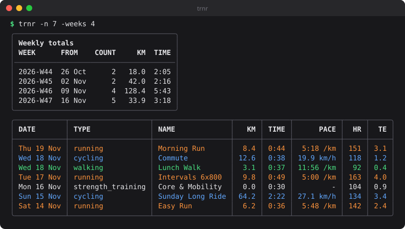

# trnr

Trainer gives a simple CLI overview of recent Garmin activities: your latest workouts
in a table, with the weekly totals above it.

<picture>
  <source media="(prefers-color-scheme: dark)" srcset="docs/screenshots/trnr-dark.svg">
  <source media="(prefers-color-scheme: light)" srcset="docs/screenshots/trnr-light.svg">
  
</picture>

<sub>Screenshots use mock data.</sub>

- **Recent activities:** date, type, name, distance, time, average heart rate and
  aerobic training effect.
- **Pace or speed:** min/km for running and walking, km/h for cycling.
- **Weekly totals:** count, distance and time per ISO week (Monday to Sunday).
- **Colored by type:** running, cycling and walking each get a color, in shades that
  work on dark and light terminals.
- **Pipe-friendly:** colors are dropped when the output isn't a terminal.

It uses the official [Garmin Connect Personal API][personal-api], so it needs only a
personal API key, not your Garmin password.

## Setup

You need [Go](https://go.dev/dl/) 1.22 or newer.

1. Create a Personal API key at
   https://connect.garmin.com/app/settings/personalApiToken.
   It's shown only once and expires after the period you choose (30 to 365 days).
2. Copy `.env.example` to `.env` and put your key in it:
   ```bash
   cp .env.example .env
   ```
3. Load `.env` into your shell. Run this from the project root, once per terminal
   session, and again after editing `.env`:
   ```bash
   set -a; source .env; set +a
   ```
   `set -a` exports every variable that `.env` sets, so `go run .` can read them.
   Check that it worked without showing the key:
   ```bash
   echo ${#GARMIN_API_KEY}
   ```

`.env` is in `.gitignore`, so your key stays out of git.

## Run

```bash
go run .
```

Or build a binary once and run that:

```bash
go build        # creates ./trnr
./trnr
```

### Flags

| Flag | Default | What it does |
|---|---|---|
| `-n` | `10` | Number of activities in the table. |
| `-type` | all | Only this activity type, e.g. `running`, `cycling` or `walking`. |
| `-weeks` | `4` | Number of weeks in the weekly totals, including this week. `0` hides the box. |

```bash
./trnr -n 20                  # the last 20 activities
./trnr -type running -weeks 8 # only runs, with 8 weeks of totals
./trnr -weeks 0               # just the table
```

### Piping

When the output isn't a terminal, trnr prints the same layout without colors, so it
works with `less`, `grep` or a file:

```console
$ ./trnr -n 3 -weeks 0 | cat
╭────────────┬─────────┬─────────────┬──────┬──────┬───────────┬─────┬─────╮
│ DATE       │ TYPE    │ NAME        │   KM │ TIME │      PACE │  HR │  TE │
├────────────┼─────────┼─────────────┼──────┼──────┼───────────┼─────┼─────┤
│ Thu 19 Nov │ running │ Morning Run │  8.4 │ 0:44 │  5:18 /km │ 151 │ 3.1 │
│ Wed 18 Nov │ cycling │ Commute     │ 12.6 │ 0:38 │ 19.9 km/h │ 118 │ 1.2 │
│ Wed 18 Nov │ walking │ Lunch Walk  │  3.1 │ 0:37 │ 11:56 /km │  92 │ 0.4 │
╰────────────┴─────────┴─────────────┴──────┴──────┴───────────┴─────┴─────╯
```

## How it works

1. trnr exchanges your API key for an access token. The token is valid for 24 hours and
   cached in `~/.cache/trnr/token.json` (file mode `0600`), so most runs skip this step.
2. It pages through your activity list until it has enough activities for the table and
   has gone back far enough for the weekly totals.
3. If the API rejects a cached token (HTTP 401), trnr gets a new one and tries once more.

## Project layout

| Path | What's in it |
|---|---|
| `main.go` | Flags and wiring. |
| `internal/garmin/` | The API client: token exchange and cache, fetching activities. |
| `report.go` | Cell formatting (km, h:mm, pace), table rows and weekly totals. |
| `render.go` | The lipgloss styles and drawing. |
| `docs/PLAN.md` | The step-by-step build plan. |

## Development

```bash
go test ./...     # unit tests; the API is faked with httptest, no key needed
go vet ./...
gofmt -l .        # lists files that need formatting; should print nothing
```

## Troubleshooting

- **`GARMIN_API_KEY is not set`:** load `.env` in this terminal (step 3 of Setup).
- **`token request failed: status 401`:** the API key expired or was revoked. Create a
  new one and update `.env`.
- **`status 429`:** too many requests. Wait a bit before trying again.

## License

Public domain, under [the Unlicense](LICENSE).

[personal-api]: https://developer.garmin.com/gc-developer-program/personal/personal-faq/
